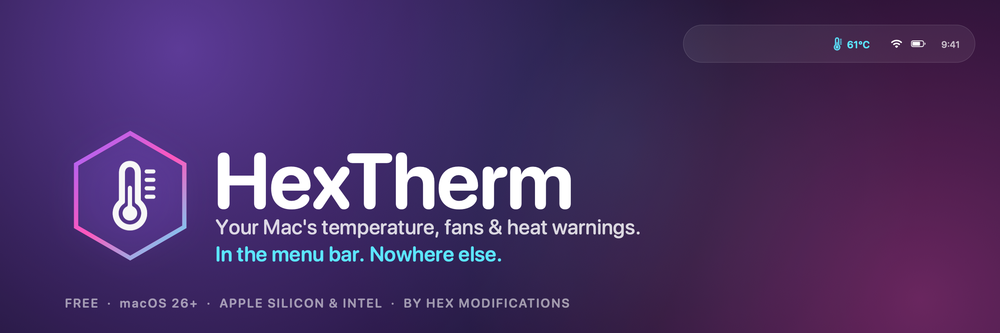
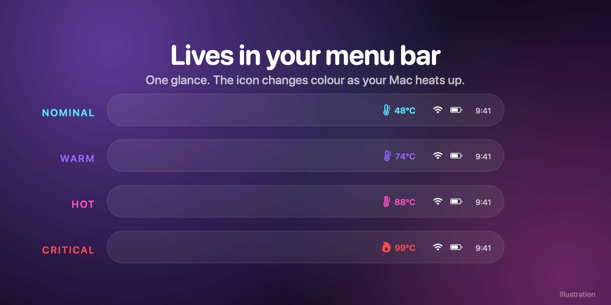
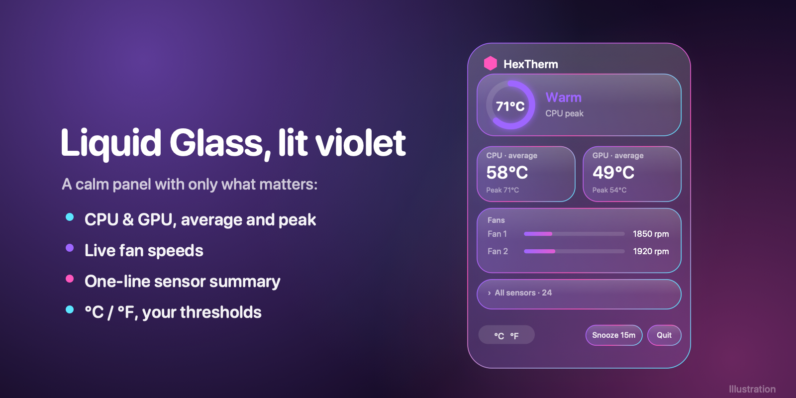
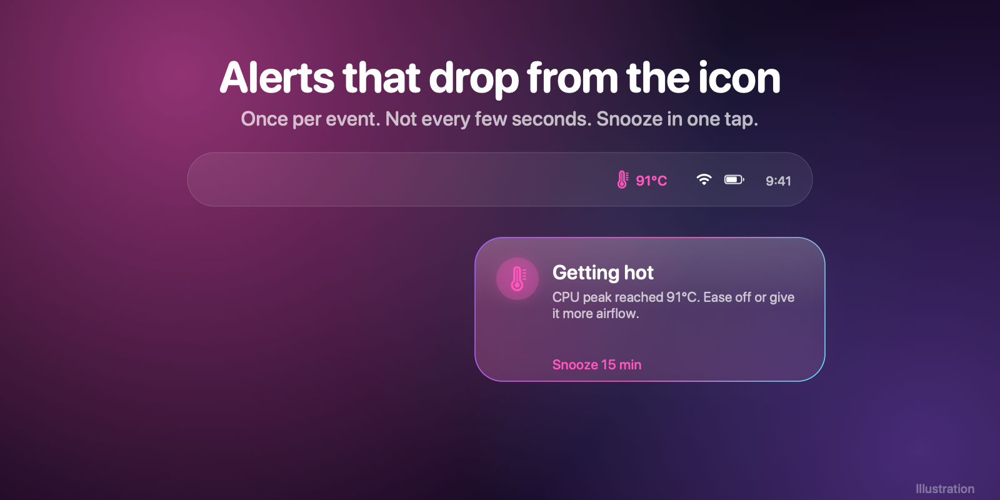
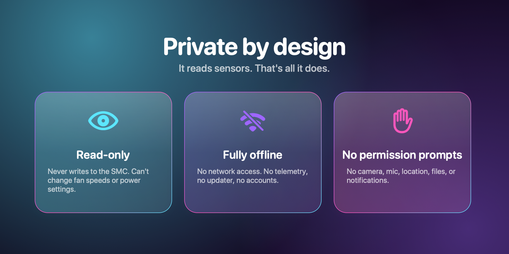

<p align="center">
  
</p>

<h3 align="center">A free, quiet Mac menu bar app for CPU &amp; GPU temperature, fan speed, and overheating warnings.</h3>

<p align="center">
  <a href="https://github.com/001Hex/HexTherm-Releases/releases/latest"></a>
  
  
  
</p>

<p align="center">
  <a href="https://github.com/001Hex/HexTherm-Releases/releases/latest"><b>⬇ Download</b></a> ·
  <a href="https://001hex.github.io/HexTherm-Releases/">Website</a> ·
  <a href="#install">Install</a> ·
  <a href="#faq">FAQ</a> ·
  <a href="https://github.com/001Hex/HexTherm-Releases/issues">Support</a>
</p>

---

**HexTherm** is a lightweight Mac temperature monitor by **Hex Modifications**. It shows how hot your MacBook is running, how hard the fans are working, and warns you before it becomes a problem. No dashboards, no benchmarks, no accounts. Works on **Apple Silicon (M1, M2, M3, M4)** and **Intel** Macs.

## Features

| | |
|---|---|
|  | **Lives in your menu bar.** A tiny icon and number that shifts from cyan to violet to magenta to red as your Mac heats up. Sits right beside the notch on MacBook Pro. |
|  | **A Liquid Glass panel.** Click for CPU and GPU average and peak, live fan RPM and a one-line sensor summary, styled to match macOS 26. |
|  | **Alerts that drop from the icon.** A small glass card appears right under the icon when your Mac runs hot. Once per event, never spammy, with one-tap snooze. |
|  | **Private by design.** Read-only sensor access, no network entitlement, no telemetry, no permission prompts. |

Also: °C / °F, adjustable refresh rate, your own warm / hot / critical thresholds, launch at login, an optional hover widget that hugs the notch, and graceful handling of fanless MacBook Air models.

> Banner images show illustrations of the interface.

## Install

1. [Download the latest `HexTherm-x.y.z.dmg`](https://github.com/001Hex/HexTherm-Releases/releases/latest) and open it.
2. Drag **HexTherm** onto **Applications**, then open it. A thermometer icon appears in your menu bar.
3. **First launch:** HexTherm isn't notarized by Apple yet, so macOS may say it can't be opened. Right-click the app → **Open** → **Open**, or run:

```bash
xattr -dr com.apple.quarantine /Applications/HexTherm.app
```

**Homebrew:**

```bash
brew install --cask 001hex/tap/hextherm
```

Verify your download against the `.sha256` file on the release page:

```bash
shasum -a 256 ~/Downloads/HexTherm-1.0.0.dmg
```

**Requirements:** macOS 26 or later. Universal app (Apple Silicon and Intel).

## Privacy and security

- **Read-only.** HexTherm only reads sensors from the System Management Controller. It never writes to it and cannot change fan speeds or power settings.
- **Offline.** No network entitlement, no connections, no telemetry, no updater, no accounts.
- **No permission prompts.** No camera, microphone, location, contacts, files, or notifications access.
- **Hardened Runtime** is on. App Sandbox is off, because macOS doesn't let sandboxed apps read the SMC; the same is true of other Mac sensor tools.

## FAQ

<details><summary><b>Does it work on M1, M2, M3, M4 and Intel Macs?</b></summary>

Yes. It's a universal app and discovers your Mac's sensors at launch instead of using a fixed list. It was developed and tested on an M4 Max MacBook Pro. If a reading looks wrong on your model, please [open an issue](https://github.com/001Hex/HexTherm-Releases/issues) with your Mac model.
</details>

<details><summary><b>Can it control my fan speed?</b></summary>

No. It's read-only by design and never writes to the SMC.
</details>

<details><summary><b>How is it different from iStat Menus, TG Pro or Macs Fan Control?</b></summary>

Those are excellent and do more, including fan control and many more sensors. HexTherm deliberately does less: temperature, fan speed and heat warnings in one quiet menu bar item. Free, offline and read-only.
</details>

<details><summary><b>How accurate are the temperatures?</b></summary>

HexTherm shows what your Mac's System Management Controller reports, the same source other Mac monitors use. It filters out placeholder and non-temperature values and shows average and peak per category, because different sensors sit in different places on the chip.
</details>

<details><summary><b>Does it work on a fanless MacBook Air?</b></summary>

Yes. It detects that there are no fans and shows temperatures only.
</details>

<details><summary><b>Is it open source?</b></summary>

No. HexTherm is free, closed-source software by Hex Modifications. See the [EULA](EULA.txt).
</details>

## Uninstall

Quit HexTherm from its panel and delete it from Applications. If you enabled "Launch at login", you can also remove it in System Settings → General → Login Items.

## Support

Open an [issue](https://github.com/001Hex/HexTherm-Releases/issues) with your Mac model, macOS version, and what you saw, or ask in [Discussions](https://github.com/001Hex/HexTherm-Releases/discussions).

---

<p align="center"><sub>© 2026 Hex Modifications · Free closed-source software, see <a href="EULA.txt">EULA</a> · Not affiliated with or endorsed by Apple Inc. Mac, MacBook and macOS are trademarks of Apple Inc.</sub></p>
