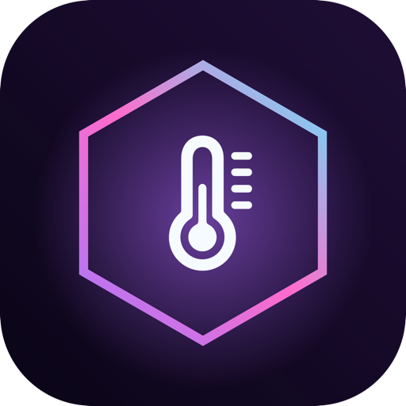

<p align="center"></p>

# HexTherm

**Your Mac's temperature, fan speed, and thermal warnings — in the menu bar, and nowhere else.**

HexTherm is a small, quiet menu bar app by **Hex Modifications**. No dashboards, no benchmarks, no accounts. A single icon that changes color as your Mac heats up, a glass panel when you click it, and a heads-up when things get too hot.

## [⬇ Download the latest version](../../releases/latest)

Requires macOS 26 or later · Apple Silicon and Intel · free

## What you get

- **A live icon in the menu bar** — shows your hottest processor temperature and shifts from cyan to violet to magenta to red as it climbs.
- **A Liquid Glass panel** — CPU and GPU average and peak, live fan speeds, and a one-line-per-category sensor summary.
- **Alerts that drop out of the icon** — when your Mac runs hot, a small glass card appears right under the menu bar item. Once per event, not every few seconds. Snooze it for 15 minutes from the card.
- **Optional notch widget** — on notched MacBooks, a tiny pill that hugs the notch and expands on hover.
- **Yours to tune** — °C/°F, refresh rate, your own warm / hot / critical thresholds, launch at login.
- **Fanless Macs just work** — MacBook Air shows "fanless" instead of broken data.

## Install

1. Download `HexTherm-x.y.z.dmg` from [Releases](../../releases/latest) and open it.
2. Drag **HexTherm** onto **Applications**.
3. Open it from Applications. A thermometer icon appears in your menu bar.

**First launch:** HexTherm isn't notarized by Apple yet, so macOS may say it "can't be opened." That's expected. Either right-click the app → **Open** → **Open**, or run:

```bash
xattr -dr com.apple.quarantine /Applications/HexTherm.app
```

Verify your download against the `.sha256` file on the release page:

```bash
shasum -a 256 ~/Downloads/HexTherm-1.0.0.dmg
```

## Privacy and security

- **Read-only.** HexTherm only reads sensors from the System Management Controller. It never writes to it and cannot change fan speeds or power settings.
- **Offline.** It has no network entitlement and makes no connections. No telemetry, no updater, no accounts.
- **No permission prompts.** No camera, microphone, location, contacts, files, or notifications access.
- **Hardened Runtime** is on. App Sandbox is off, because macOS doesn't allow sandboxed apps to read the SMC — the same reason other Mac sensor tools aren't sandboxed.

## Uninstall

Quit HexTherm from its panel, then delete it from Applications. If you enabled "Launch at login", it's listed (and removable) in System Settings → General → Login Items.

## Support

Open an [issue](../../issues) with your Mac model, macOS version, and what you saw.

---

HexTherm is closed-source freeware © Hex Modifications. See [EULA](EULA.txt). Not affiliated with or endorsed by Apple Inc.
